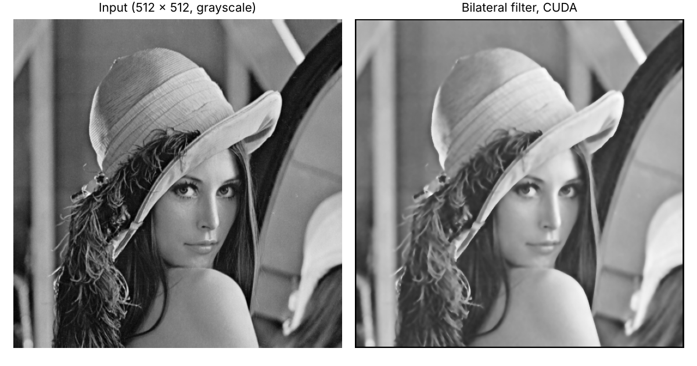
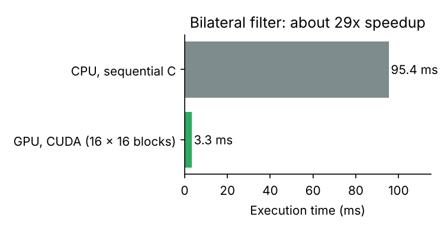

# HPC for AI – CUDA bilateral filter and Vision Transformer optimization

Two-part project on high-performance computing for AI, carried out in a team of two at CY Tech (High Performance Data Analytics track, 2025).

## 1. Bilateral filter in CUDA – [`TP1/`](TP1)

Edge-preserving image denoising, first implemented sequentially in C, then ported to CUDA.

| Version (512 × 512 image) | Execution time |
|---|---:|
| CPU, sequential C | 95.4 ms |
| GPU, CUDA (16 × 16 blocks) | 3.3 ms |

**≈ 29× speedup.** The block-size study (8 × 8 to 64 × 8) found the best time with 32 × 32 blocks (3.0 ms). Details in [`TP1/README.md`](TP1/README.md).

## 2. Vision Transformer optimization – [`Project/`](Project)

Adapting **ViT-B/16** (Hugging Face `google/vit-base-patch16-224`) to CIFAR-10, then testing compression techniques for deployment.

| Model | Accuracy | Fine-tuning time | Size |
|---|---:|---:|---:|
| Full fine-tuning | 97.27 % | 21 min 30 s | 343 MB |
| Freeze all but last 3 layers | 97.24 % | 10 min 30 s | 343 MB |

- **Fine-tuning:** freezing all but the last three layers halves training time for a 0.03-point accuracy loss, so this model was kept as the baseline.
- **Quantization and pruning:** both were tested (several sparsity levels, with and without removing zeroed weights). In this setup they cut accuracy too much, so the frozen fine-tuned model was kept. Full analysis (in French) in [`Project/README.ipynb`](Project/README.ipynb).

## Contributions

Team project of two. We worked on both parts together and shared the work. This repository is a fork of [PaulSerin/PAH](https://github.com/PaulSerin/PAH), where the first version of the code was committed. My own commits cover the ViT-B/16 fine-tuning and compression experiments (`Project/VITB.ipynb`), their write-up (`Project/README.ipynb`) and the top-level README.

## Tech stack

C · CUDA · Python · PyTorch · Hugging Face Transformers · Jupyter
